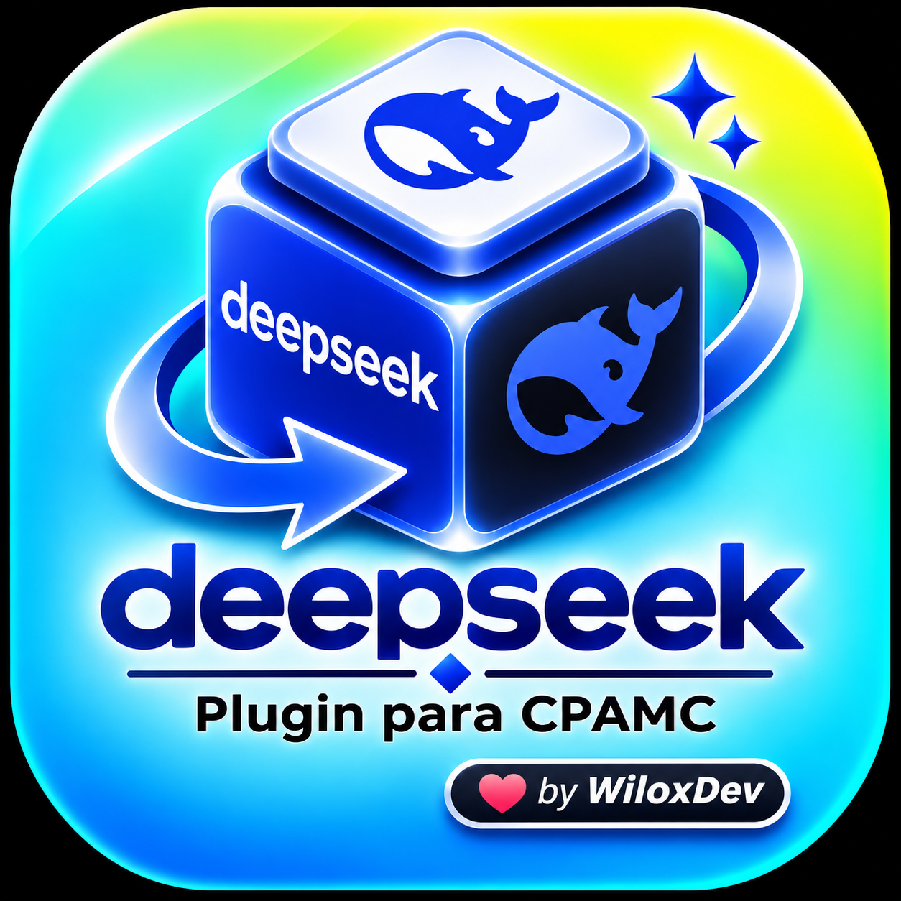

<p align="center">
  
</p>

# 🐋 DeepSeek Plugin for CLI PROXY API CONSOLE (CPAMC)

[](https://gentlemanprogramming.com/gentle-hub/)
[](#)
[](https://bit.ly/48zTJUo)
[](LICENSE)

Plugin oficial de alto rendimiento escrito en Go (C-ABI) que integra de forma nativa los modelos de **DeepSeek** en **CLI PROXY API CONSOLE (CPAMC)** y el ecosistema **Gentle-Shell / Pi**, con soporte para pools multi-cuenta y conmutación automática de cuotas (429) mediante **CPAMC Auto Switcher Pro**.

> 💬 **Comunidad y Soporte Oficial:** `wilox2` · [Servidor de Discord](https://bit.ly/48zTJUo)

---

## 🌟 Modelos Soportados y Capacidades

| ID del Modelo | Nombre en Gentle Shell | Ventana de Contexto | Características |
| :--- | :--- | :---: | :--- |
| `deepseek-chat` | DeepSeek V3 (CPAMC) | 128,000 tokens | Modelo de chat ultrarrápido, ideal para programación general. |
| `deepseek-reasoner` | DeepSeek R1 (CPAMC) | 128,000 tokens | Razonamiento profundo (Chain-of-Thought), resolución matemática y refactorización compleja. |

---

## 🛠️ Métodos de Instalación

Elige el método que mejor se adapte a tu entorno:

### Método 1: Compilación local con Go (Recomendado para Linux / WSL / macOS)
Requiere tener Go (>= 1.22) y compilador C (`gcc` o `clang`):
```bash
git clone https://github.com/WiloxDev/deepseek-plugin-cpamc.git
cd deepseek-plugin-cpamc
make install
```
El archivo compartido `deepseek-plugin-linux-amd64.so` se copiará automáticamente a tu carpeta de plugins de CPAMC (`~/services/cliproxy/plugins/` o `~/.cli-proxy-api/plugins/`).

---

### Método 2: Despliegue en Docker
Si ejecutas CPAMC dentro de un contenedor Docker, monta la biblioteca compilada en el volumen de plugins:
```yaml
services:
  cpamc:
    image: ghcr.io/router-for-me/cliproxyapi:latest
    volumes:
      - ./plugins/deepseek-plugin-linux-amd64.so:/app/plugins/deepseek.so:ro
      - ./config.yaml:/app/config.yaml:ro
    ports:
      - "8317:8317"
```

---

## ⚙️ Configuración de Credenciales en CPAMC

### Opción A: A través de la Consola Web Oficial
1. Inicia CPAMC y abre tu navegador en:  
   👉 **[http://127.0.0.1:8317/management.html](http://127.0.0.1:8317/management.html)**
2. Ve a la pestaña **Plugins / Providers**.
3. Selecciona **DeepSeek** e introduce tu API Key oficial (`sk-...`).

### Opción B: A través de `config.yaml`
Edita tu archivo de configuración de CPAMC:
```yaml
plugins:
  deepseek:
    enabled: true
    api_key: "sk-tu-api-key-de-deepseek"
    base_url: "https://api.deepseek.com"
```

---

## 🚀 Uso en Gentle Shell

Una vez cargado el plugin en CPAMC:

1. Abre tu terminal Gentle Shell.
2. Escribe `/cpamc refresh` para sincronizar los modelos disponibles.
3. Escribe `/model` y selecciona:
   - `cpamc/deepseek-chat`
   - `cpamc/deepseek-reasoner`

---

## 🔄 Pools Multi-Cuenta y Auto Switcher Pro

Si utilizas dos o más cuentas o claves de DeepSeek para evitar límites de tasa o saldo:
- Instala la extensión complementaria:  
  👉 **[WiloxDev/cpamc-auto-switcher-pro](https://github.com/WiloxDev/cpamc-auto-switcher-pro)**
- Ante cualquier error de límite de cuota (`HTTP 429`), el balanceador conmutará en milisegundos a la siguiente cuenta disponible **sin interrumpir la generación de código**.

---

## 🌐 Ecosistema de la Suite WiloxDev para Gentle Hub

- 🌉 **[bridge-cpamc-oficial](https://github.com/WiloxDev/bridge-cpamc-oficial)** — Puente e instalador oficial multiplataforma de CPAMC.
- ⚡ **[cpamc-auto-switcher-pro](https://github.com/WiloxDev/cpamc-auto-switcher-pro)** — Balanceador de carga y conmutación automática anti-429.
- 👁️ **[gentle-context-lens](https://github.com/WiloxDev/gentle-context-lens)** — Cabina de contexto, semáforo de tokens y poda quirúrgica.
- 🤖 **[gentle-claude-bridge](https://github.com/WiloxDev/gentle-claude-bridge)** — Conexión directa a Claude Code Pro/Max sin API keys por token.
- 🚀 **[gentle-antigravity-bridge](https://github.com/WiloxDev/gentle-antigravity-bridge)** — Puente Google Antigravity (Gemini 2.0 / Claude 3.7 / Opus).

---

## 📄 Licencia

MIT © Wilox. Desarrollado para la comunidad de Gentle Shell y CLIProxyAPI.
